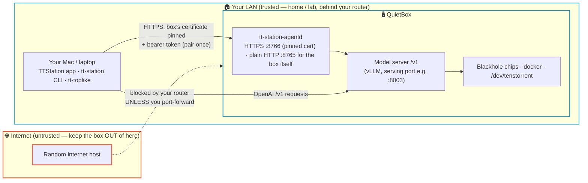

# tt-station — Security FAQ

*Straight answers about what tt-station exposes, how access works, and how to lock it
down — written for a **solo developer** running a QuietBox on their own network, not for
an enterprise security team.*

## TL;DR

tt-station is built for the **trusted network you already control** — your home or lab
LAN, behind your router/firewall. On that network it's designed to be friendly and
low-friction: discover the box, pair once, run models. It is **not** hardened for the
open internet or a hostile multi-tenant network, and it doesn't try to be. If you keep
the box on a network you trust and don't port-forward it to the internet, the defaults
are reasonable. If you want more, there's a [hardening checklist](#hardening-checklist)
at the end.

Nothing here is scary — but everything here is honest. You should know exactly what's on
the wire.

---

## The shape of it



**The trust boundary is your LAN.** The agent listens on `0.0.0.0`, so anything on your LAN
can reach it. That's deliberate — it's how your Mac discovers and talks to the box. Other
computers and phones talk to it over **HTTPS on the control port + 1** (default `8766`),
trusting the box's own certificate by its fingerprint; plain HTTP on `8765` serves only the
box itself (and, for `/v1`, its Docker apps).

---

## How access works

There are two layers of "getting in": **pairing** (to control the agent) and, optionally,
**SSH key provisioning** (to get a shell). Both start from you, at the box.

```mermaid
sequenceDiagram
    participant You as You (at the box)
    participant Mac as Mac (app / tt-station CLI)
    participant Box as tt-station-agentd

    Note over Mac,Box: 1. Pairing — exchange a short-lived code for a bearer token
    Mac->>Box: POST /pair/init
    Box-->>Mac: pair_id
    Box-->>You: shows a 6-digit code on its screen<br/>(GTK panel / tt-station console), valid 120s
    You->>Mac: read the code, type it in
    Mac->>Box: POST /pair/complete { pair_id, code }
    Box-->>Mac: 256-bit bearer token (stored in your Keychain)

    Note over Mac,Box: 2. From now on, control calls carry the token
    Mac->>Box: POST /run · /stop · /reset · GET /endpoint<br/>Authorization: Bearer <token>
    Box-->>Mac: ✅ (401 without a valid token)

    Note over Mac,Box: 3. OPTIONAL — grant SSH (only if you ask for it)
    Mac->>Box: tt-station pair --enable-ssh → POST /ssh/authorize (your public key)
    Box-->>Box: append your key to ttuser's ~/.ssh/authorized_keys<br/>(tagged ttstation:<label>)
```

**The pairing code is a "read it off the box" secret.** It only appears on the box's own
screen (the GTK panel or `tt-station console`), lives 120 seconds, and a given attempt allows only
5 wrong guesses before it's discarded. So to pair, you generally need to be *looking at the
box*. The result is a **256-bit random bearer token** — that's the real credential; the
code is just how you bootstrap it.

**Every pairing is a device you can see and remove.** The box records each one as a device
(the name and platform the client sends, e.g. "Jane's MacBook · macOS", when it paired, when
it was last used) and keeps only a SHA-256 of its token, never the token. A device unused for
**90 days** is signed out automatically; any use restarts the clock. Pairing a new device is
announced as a box event (desktop notification and phone push).

---

## What can someone on my network do?

Almost nothing without pairing. Every route needs a paired device (or the box's own user,
see below) **except** this short list, which is what a device needs to find the box and pair:

| Endpoint | What it exposes / does |
|---|---|
| `GET /status` | box name, chips, device mesh, serving state |
| `GET /tls` | the HTTPS port and the certificate fingerprint to pin |
| `POST /pair/init` · `/pair/complete` | start/finish pairing (needs the code shown on the owner's screens) |
| `POST /pair/offer` | pairing for the box's own user (needs the agent's `local-secret` file) |
| `GET /app/…` | the desktop app's pages (no data in them) |

The model API (`/v1/…`) checks its own credential, an app key, and a bring-up run's driver
checks its run secret. The agent enforces this as a default-deny layer, and a test walks
every route in the router to check that each one is either on the list above or answers
`401` without credentials (`tests/access_control.rs`).

**The box's own user.** A program on the box that connects over plain HTTP is trusted
without pairing (the console, the panel, tt-toplike) only if it runs as the agent's own
account: the agent looks the connection up in `/proc/net/tcp` and checks its owner's uid.
Another account on the box, root, or a container on the host network gets no such trust.

## Owners and members

Each paired device is an **owner** or a **member**.

- **Owners** manage the box: they see and remove other devices, make other devices owners
  (or members again), add and remove SSH keys, make/change/revoke app keys, use power
  (sleep, restart, shut down, reset chips), install or undo updates, reset the box, change
  the security settings, answer bring-up approvals, rename or remove people, read the
  activity log, stop containers the box didn't start (the Doctor's "stop stray
  containers"), build and download the Doctor's support bundle (it carries the agent's and
  the serving logs, redacted), and choose who may start and stop models.
- **Members** use the box: chat, their own research, Code, the studio, the library, their
  own memories and transcripts, Code and routine approvals, reading the Doctor's verdicts,
  and starting and stopping models unless an owner has said only owners may (below).

Who is an owner: the first device the box ever pairs, the desktop app on the box itself and
anything paired with `tt-station-agentd pair` (both use the box user's local secret), and any
device an owner promotes. The box always keeps at least one owner. On upgrading, devices
paired before roles become members, except the box's own desktop app, which becomes (or
re-pairs as) an owner by itself, so nobody is locked out.

Being a person on the box (Settings → People) means seeing that person's memories, so a
member can only claim a person no other device belongs to yet; sharing a person between
devices is an owner's call (Settings → Devices and pairing). A member's "forget
everything" forgets its own memories, not the household's.

**Who may start and stop models.** The served model is shared: stopping or switching it
changes it for everyone. An owner chooses who may (Settings → Models → Who can start and
stop models; `model_control` in `PUT /data/settings`): **anyone** on the box (the default,
so boxes that had no such setting work as they did) or **owners only**. With owners only, a
member gets `403` "Only owners can start or stop models on this box." from everything that
starts, stops or switches serving: `POST /run`, `/stop`, `/serve` (Models, Code's model
picker), `/modes/{id}`, `/coserve`, `/community/serve`, `/vllm/native/serve`, the go-ahead to
switch for a transcription (`/jobs/{id}/run`), writing a mode schedule (`POST`/`PATCH
/schedules`), starting or stopping a check-up (`POST /evals`, `/evals/stop`: it holds the
model for minutes, about fifteen with agent reliability), and the Doctor's `restart_model`.
Tori's `run_model`, `stop_model` and `switch_mode` are refused before a confirm card is
offered (Tori says why), and a card offered earlier is refused on confirm. A routine acts
for whoever ran it by hand, or, when it runs on its schedule, whoever last wrote it: run for
a member, it doesn't take `start_model`, `stop_model` or `evaluate_model` (or a mode
switch) on its own, even when it was given them ahead of time, and a member can't approve
one of those (or `reset_chips`, an owner's) when a run asks. Routines from before this was
kept act as the box. Each refusal, and each change of the setting (`model_control`, "anyone
-> owners"), is in the activity log. What the box does by itself isn't a person's say-so
and isn't refused: starting the last model after a power cut, the idle sleep and wake, and
the transcription queue starting Whisper when nothing is serving.

**Research reports are per person.** Each report records the device that started it.
Members see their own reports and the ones shared with everyone on the box; owners see all.
Someone else's report is `404` everywhere (reading, explaining, following up on it), so a
member doesn't learn its id. Its starter or an owner renames, stops, deletes or shares it
(`POST /research/{id}/share`, audited as `research_share`); reading a shared report doesn't
make it yours to change. Reports from before this was kept, and the box's own, have no
starter: they're the owners' until an owner shares them. Transcription jobs work the same
way (`docs/reference/jobs.md`), except that anyone who can see a shared job may delete it.

**A folder a member's sandbox worked in.** Code in the sandbox can write anything into its
project folder, and some of what it leaves there runs later by itself: git hooks, a
Makefile, npm scripts, `.claude` settings. Run outside the sandbox, as an owner can, those
would run as the box's own account. So the box remembers which folders members' sandboxed
sessions used, and who (`<config>/code/shared-folders.json`, 0600), and before an owner
starts Code without the sandbox, or a terminal agent, in one of them (or a folder inside or
around one) it answers `409 {needs_confirm: "shared_folder", used_by, folder}`. The desktop
app says who worked there and asks; going ahead sends `confirm_shared: true`, is written to
the activity log (`shared_folder_confirmed`), and clears those uses until a member works there
again.

**Live telemetry** lists the box's processes; for members, each command line is cut to the
executable's name. Removing a device closes its open terminals, log and telemetry streams
and chat streams at once.

## Activity log

The box keeps an append-only log of who did what (`~/.config/tt-station/audit.jsonl`,
`0600`, rotated at 10 MB, five files kept): pairing, removed devices, owner changes, resets,
SSH and app keys, power, security settings, updates, answered approvals, model starts and
stops, who may start and stop models, research reports shared or unshared, meeting
recordings started and stopped, and every owner-only request a member was refused (and
every model start or stop refused to one). It records device ids and names,
never tokens or keys. Owners read it in Settings → Security and activity → Activity log, or
`GET /audit`.

### Apps from the store (Connect)

Every app TT Station installs (`crates/tt-station-agentd/src/apps.rs`) listens **only on
the box** (`127.0.0.1:<port>`). On the box, Open goes straight to it; the desktop app on
another computer opens it through its SSH tunnel to the box; a plain browser on another
computer gets "This app is only available on the box" instead of a broken page.

An app's **Open to the network** setting (off by default; `PUT /apps/{id}/network
{open}`) publishes it on every address of the box after a confirm that says who can reach
it and what they can do. Apps whose own sign-in is off by default either get it turned on
when shared, or can't be shared:

| App | Open to the network |
|---|---|
| LobeChat | yes: its access code (generated, shown on its tile) is always on |
| Flowise | yes: `FLOWISE_USERNAME`/`FLOWISE_PASSWORD` (generated, shown) are always set, so nobody can claim its admin account without them |
| Langflow | yes: sharing adds `LANGFLOW_AUTO_LOGIN=False`, so you sign in as `langflow` with the generated password (shown) instead of everyone getting the superuser, which can run Python code |
| LightRAG | yes: `AUTH_ACCOUNTS` (generated password, shown) is always set; sharing adds `WHITELIST_PATHS=/health`, so its Ollama-style `/api/*` isn't left open |
| n8n | only after its owner account exists (made on the box): until then whoever opens it first becomes its owner. TT Station asks n8n (`/rest/settings`) before allowing it |
| Scrapling, OpenClaw | yes: their bearer token / gateway token (generated, shown as the access code) is always on |
| Jupyter, OpenHands | no: they run code on the box |
| SearXNG, Vane, Crawl4AI, ComfyUI, Local Deep Research | no: no sign-in of their own (or anyone can sign up), and they spend the box's model or fetch pages for whoever reaches them |

**A running container keeps the address it was started with.** A change applies the next
time the app is started from TT Station, which re-creates the container (same data volume,
same password, same app key); the tile says "Still reachable from the network until it's
restarted here" and offers Restart now. A box reboot restarts containers as they were.
(`tt launch`'s Open WebUI and AnythingLLM, under "Chat for everyone", are separate: they
are meant for the household and stay on the network.)

### Web text in Tori and routines

Text from the web (a search, a page read) can be written to steer the model. Once it has
come into a Tori turn or a routine run:

- **Acting steps wait for a person.** Tori asks before `remember`, opening things, starting
  research and the like. A routine, which nobody may be watching, doesn't run them: it
  queues each one (its actions too, even ones it was given ahead of time) with a
  notification, carries on, and its report ends with what's waiting. An allowed step runs
  when it's answered (within a day); a declined one is dropped.
- **New web addresses wait for a person.** A page can ask the model to fetch
  `https://collector.example/?q=<what you said>`, and the request itself carries the data
  away. So an address is fetched or opened without asking only if it was in the person's
  own messages (a routine's goal counts) or came back from a search or page in that same
  turn. A parent of one of those is fine; one with a query or path segment none of them
  had is new. Research jobs only read their searches' results.
- **Not covered:** the words of a web search itself (`web_search`'s query goes to the
  search engine), and agents with their own tools (Code sessions, Hermes, OpenClaw).

### Pairing codes and push notifications

A push notification's text passes through Apple. When another computer asks to pair, the
push says only "A computer is asking to pair: open TT Station to see the code"; the code is
shown in TT Station (the desktop app, and the phone app's banner while it's open), which
reads it from the box over its authenticated connection (`GET /events`). Every other push
works the same way: Apple sees generic words for the kind of event and an event id; the
iPhone app fills in the real text from the box itself (see
`docs/reference/alerts-and-power.md`).

## Privacy: recording and notifications

### Recording in the room

Any paired device, a member's phone included, can have the box record a meeting through
its microphone and speakers (`POST /record/start`, or asking Tori), for up to four hours.
So the room is always told, whoever started it and from wherever:

- **The box chimes.** Two rising notes on the box's speakers when a recording starts, the
  same notes falling when it stops or ends on its own (a device unplugged, or the four
  hours ran out). The tones are generated by the agent (`chime.rs`), not a sound file.
- **The desktop app on the box shows a banner** on every screen while it records:
  "Recording in this room · started by *person or device* · *time* · Stop". Anyone at the
  box can stop it there. (The app on another computer doesn't show it: that isn't the room.)
- **The other paired phones are notified:** "The box started recording". Like every push,
  it carries no content through Apple; the app shows who started it from the box itself.
  The phone that started it isn't notified (it knows).
- **The activity log** records who started it (`record_start`, with the device and the
  recording's id) and who stopped it (`record_stop`, or `record_end` when it ended on its
  own).

**Tori listening for one request** (`POST /voice/hear`) is different: it opens the
microphone for a single utterance (a minute at most), transcribes it, and keeps nothing.
It gets a short, quiet tick on the box's speakers as the microphone opens, played to the
end before listening starts so it isn't heard as speech, but no banner, notification or
log line: those would fire on every spoken request.

The chime needs the box's speakers to be on and audible; a muted or unplugged speaker
means the banner and the phones are the cue.

### Who gets which notification

Every event has an audience, and the same rule decides whose phones are pushed and who
sees the event in `GET /events`:

| Event | Goes to |
|---|---|
| The box's own news: a model ready or failed, a download, hot chips, power, the box online, schedules | everyone |
| A recording started or stopped | everyone (it concerns the room), except the phone that started it |
| A research report | the person who asked; the owners when nobody in particular did |
| Pairing requests (with the code), new or removed devices, approvals (Code, routines, bring-up), transcripts, Code sessions, routines, Orchard, box checks | owners |
| A test notification | the phone that asked |

A phone's notifications follow the device it registered with (its pairing token) and the
person that device is (Settings → People). A device that's signed out or expired gets
nothing, even though Apple still knows the phone. A phone registered before this routing
existed gets only the household's news until the app next opens and registers again. A
member's `/events` shows the household's events and their own, never another person's
or the owners'.

---

## FAQ

**Is the traffic encrypted (TLS/HTTPS)?**
Yes, from every other computer and phone. The box makes its own certificate once and serves
the control plane over HTTPS on the control port + 1 (`8766`). Clients **pin** that
certificate's SHA-256 when they pair — the phone from the QR code, the desktop app from the
pairing link, the `tt-station` CLI from `GET /tls` (shown to you, and checked against `--fp`
or the link's `fp` when you give one) — store it with the token, and refuse any other
certificate afterwards, so the bearer token never crosses the network in the clear. Plain
HTTP is for the box itself (`127.0.0.1`); other computers get it only for `/v1`, and only if
the owner turns that on. Still: don't expose the ports to the internet; use a VPN or
Tailscale (see [hardening](#hardening-checklist)).

**What happens if the box's certificate changes?**
Every client refuses to talk to it. The CLI says `certificate changed: <host> presented a
certificate with SHA-256 … but this computer paired with …` and sends nothing. The
certificate is kept across restarts and upgrades, so a change means the box was reinstalled
(its config folder wiped) — or something on the network is answering for it. Check the
fingerprint on the box (Settings → Security and activity) and pair again. Details:
[CLI HTTPS and pinning](reference/cli-https-pinning.md).

**I paired the CLI before HTTPS. Is my pairing still good?**
Yes. The first command that uses it finds the box's HTTPS, pins the certificate it presents
(trust on first use), stores it with your token and tells you so. To verify rather than
trust, pair again with `tt-station pair <host:port> --fp <fingerprint shown on the box>`.

**Can a box open things on my computer?**
Only if you say so. When TT Station runs on another computer, Tori's computer tools act on
that computer. Before a box opens a web or mail link, or launches an app, the desktop app
shows a dialog with the box's name and address and exactly what will open (the full link, or
the app), with **Allow once**, **Always allow <site/app> from <box>** and **Don't allow**
(the default; closing the dialog is "don't allow"). "Always" is remembered per box and per
site (scheme, host and port) or app; see and clear those choices in Settings → General →
This app, and they're dropped when you remove the box. Links with hidden characters, a
user name or password, or anything but `http`, `https` and `mailto` never open; look-alike
host names are shown in their real (punycode) form. `open_folder` opens folders only, never a
file or an app.

**How are app keys stored?**
As SHA-256 digests in `~/.config/tt-station/app-keys.json` (`0600`): a key is shown once,
when it's made. New keys are 256 random bits and can be given an expiry. Over plain HTTP the
model API takes app keys only; a paired device's own token works there over HTTPS only.

**Is the model API (`/v1`) itself protected?**
By default, **no** — the agent launches the model server with `--no-auth`, so anyone who
can reach the serving port on your LAN can send it OpenAI-style requests (i.e. use your GPU
time). That's the friendly default for a personal box. Start the agent with `--require-auth`
if you want the served API to require a key.

**What does "pair with SSH" actually grant?**
`tt-station pair --enable-ssh` (and the `/ssh/authorize` route) appends **your** SSH public key to
the box user's (`ttuser`) `~/.ssh/authorized_keys`, tagged with a `ttstation:<label>`
marker. That's a **full login shell** as that user — the same access as if you'd run
`ssh-copy-id` yourself. It's **opt-in** (nothing installs a key unless you ask), the key is
validated (only well-formed `ssh-ed25519`/`ssh-rsa` keys, label sanitized against injection),
and `.ssh`/`authorized_keys` permissions are enforced (`0700`/`0600`). Revoke any time with
`tt-station ssh-authorize --revoke` (removes only the `ttstation:`-tagged line) — it won't touch
keys you added by hand.

**Where are the secrets stored?**
- On the **box**: paired devices live in `~/.config/tt-station/agentd-tokens.json`, written
  `0600` (owner-only). It holds a SHA-256 of each token, not the token, so a copy of the file
  can't be used to sign in. (A file from before device tracking, a plain list of tokens, is
  converted in place on the agent's first start; those devices show as "Paired before device
  tracking".)
- In the **TT Station desktop app**: tokens are encrypted with the operating system's
  keychain (macOS Keychain; GNOME Keyring/KWallet on Linux). Where Linux has no keyring, the
  app says so in Settings and keeps the token in an owner-only (`0600`) file instead.
- On your **Mac**: the `tt-station` CLI stores its token, together with the box's HTTPS port
  and pinned certificate fingerprint, in the macOS Keychain (`~/.config/tt-station/secrets.json`,
  `0600`, as fallback and on Linux). The app tracks *which* hosts are paired locally.

**What privileges does the agent run with?**
It runs as **you** — a `systemctl --user` service under your own account (not root). It can
do what you can: talk to docker, `/dev/tenstorrent`, and `tt-smi`. There's no privilege
escalation and no separate service account; the box is assumed to be your single-user
machine.

**How do I revoke access or wipe pairings?**
- **One device**: TT Station → Settings → **Devices and pairing** → Remove (or
  `DELETE /devices/{id}`; `GET /devices` lists them). It stops working on its next request,
  and its open terminals close. Removing the computer you're on signs it out.
- **Reset** (GTK panel button, or clear the box's token store): forgets **all** pairings,
  stops the serving model, resets the board — a clean slate. Clients must pair again.
- **Revoke SSH**: `tt-station ssh-authorize --revoke` removes the tt-station-added key.
- **Stop it entirely**: `systemctl --user stop tt-station-agentd` — the control plane goes
  offline; a running model container keeps serving until you stop it.

**Can I put this on the internet / access it remotely?**
Don't expose the ports directly. Use a VPN or Tailscale so the box stays on a "virtual LAN"
you control — HTTPS with a pinned certificate protects the token on the wire, but the
pairing endpoints and the always-open reads are still meant for a network you trust.

**Does the box "phone home" / send telemetry anywhere?**
No. Everything is on your LAN. `tt-smi` telemetry and the process list are only sent to
clients that connect to *your* box's `/telemetry` WebSocket. There's no external analytics.

---

## Hardening checklist

For the cautious solo dev, or a box on a network you don't fully trust. None of this is
required for a normal home/lab setup:

- [ ] **Keep it off the internet.** Don't port-forward `8765` (or the serving port). Confirm
      your router isn't exposing them.
- [ ] **Remote access via VPN/Tailscale**, never a raw port-forward.
- [ ] **Firewall the ports** to specific trusted hosts if your LAN has devices you don't
      trust (e.g. IoT gadgets, guests): restrict `8765` and the serving port with `ufw`/nftables.
- [ ] **Require auth on the model API**: run the agent with `--require-auth` so `/v1` isn't
      open to the whole LAN.
- [ ] **Mind the telemetry process list**: don't launch box processes with secrets in their
      argv; the (unauthenticated) `/telemetry` stream exposes command lines.
- [ ] **Remove devices you don't recognize** (Settings → Devices and pairing). If
      you suspect a token leaked and can't tell which, Reset the box (signs out every device)
      and re-pair; revoke any SSH keys you didn't intend to keep.
- [ ] **Only `--enable-ssh` when you mean it** — it grants a shell. Audit `ttstation:`-tagged
      lines in `~/.ssh/authorized_keys`.
- [ ] **Pair the CLI with the fingerprint**: `tt-station pair <host:port> --fp <first 16+ hex
      digits shown on the box>`, or `--link` with the box's pairing link.
- [ ] **Review "always allow" choices** for what boxes may open on your computer (desktop app:
      Settings → General → This app).

---

## What we intentionally keep simple (and why that's fine here)

Being upfront about the trade-offs, so there are no surprises:

- **Pinning, not a certificate authority.** The box's certificate is its own; clients trust
  it by fingerprint, learned at pairing. A CLI pairing that predates HTTPS is pinned on first
  use. Mitigation: compare the fingerprint the CLI shows (or pass `--fp`) with the one on the
  box's screen.
- **No user accounts / RBAC.** One bearer token = full control; the box is a single-operator
  machine. There's no notion of "read-only users" beyond the always-open informational reads.
- **The pairing code isn't a brute-force fortress.** It's a short-lived (120s), on-screen
  6-digit code with 5 guesses per attempt — its real protection is that an attacker must
  already be on your LAN *and* the window is tiny. It's a bootstrap for the 256-bit token,
  not the security boundary itself. On a trusted LAN this is a non-issue; on a hostile LAN,
  firewall the port.
- **The served `/v1` is unauthenticated by default.** Friendly for personal use; flip
  `--require-auth` if that matters to you.

These are deliberate choices for the target audience — a developer running their own box on
their own network. tt-station aims to make *that* experience delightful, and to be honest
with you about where the edges are so you can decide what (if anything) to lock down.

---

*Questions this doesn't answer, or something that looks wrong? The source is the truth —
`crates/tt-station-agentd/src/routes.rs` (the routes + auth), `authkeys.rs` (SSH key
handling), `pairing.rs` (codes + tokens), and `sessions.rs` (paired devices).*
